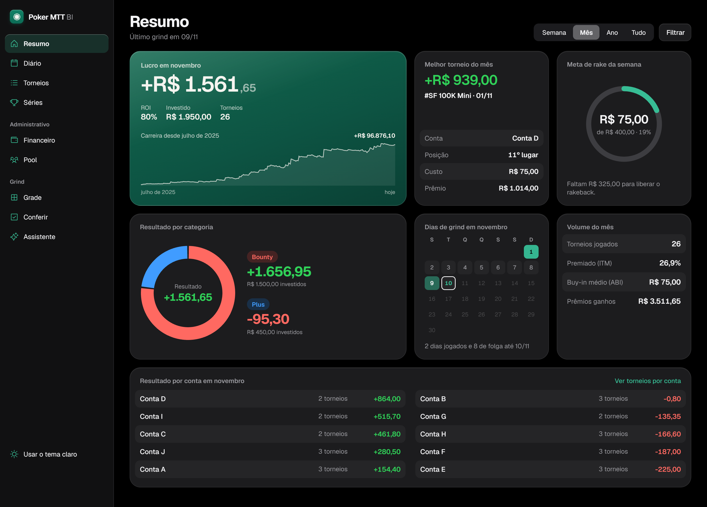
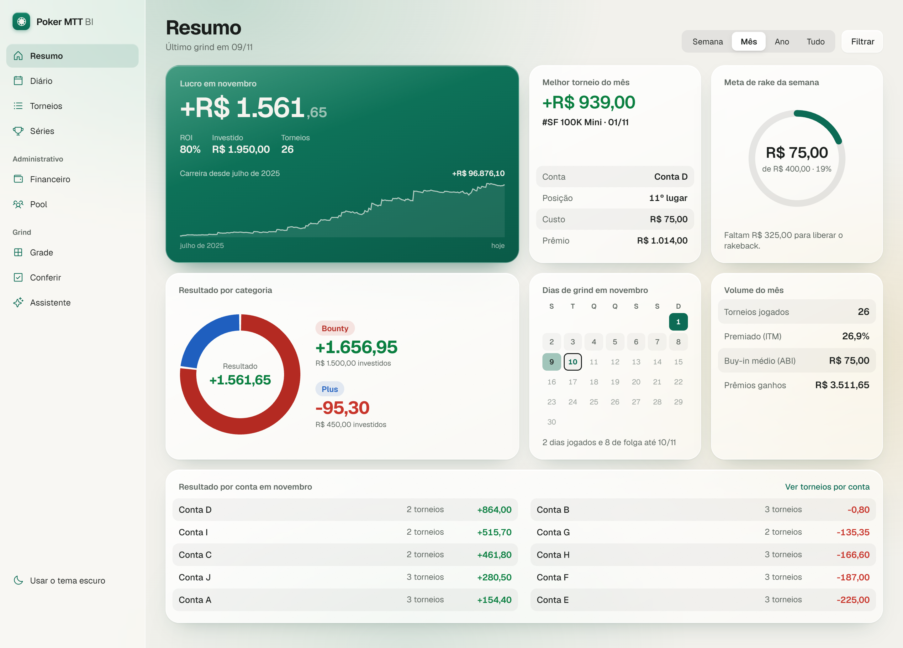
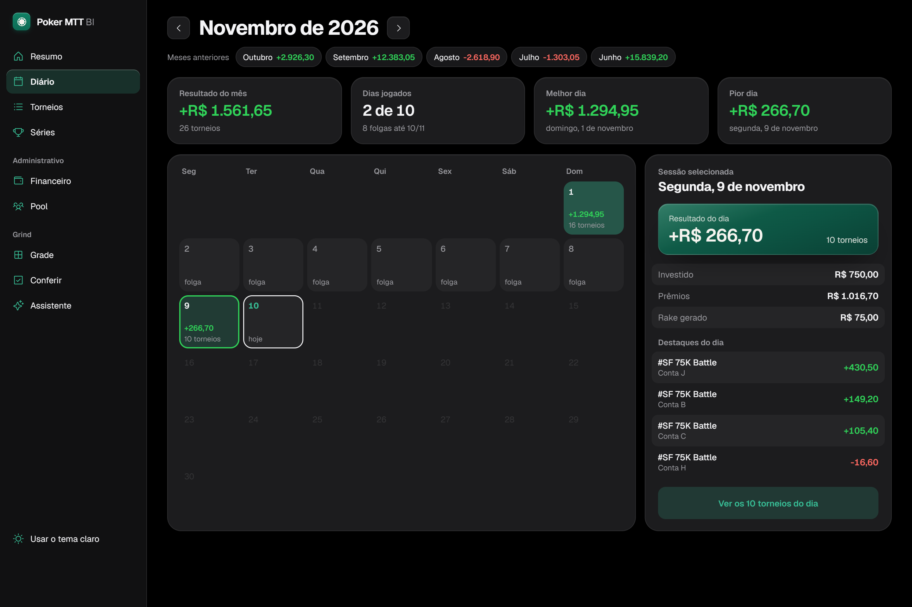
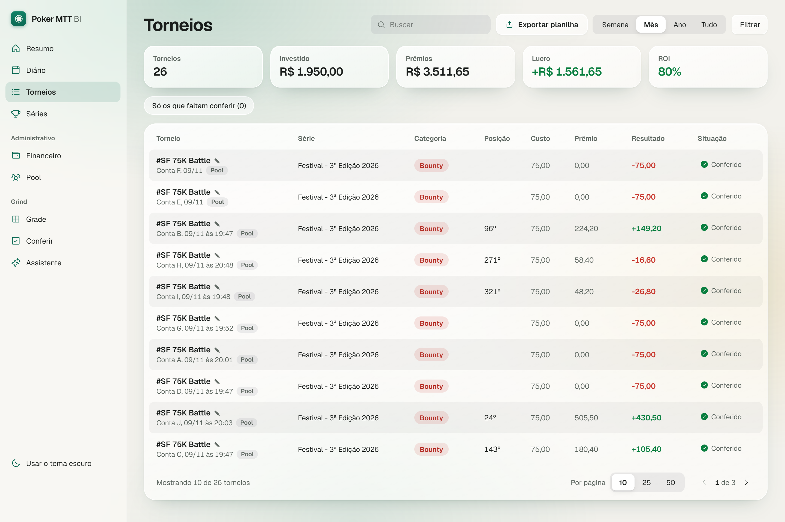
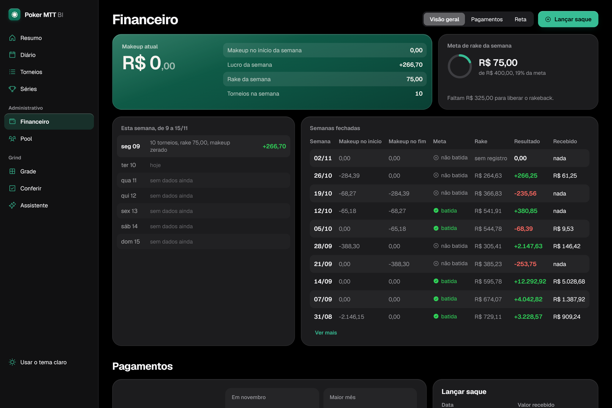
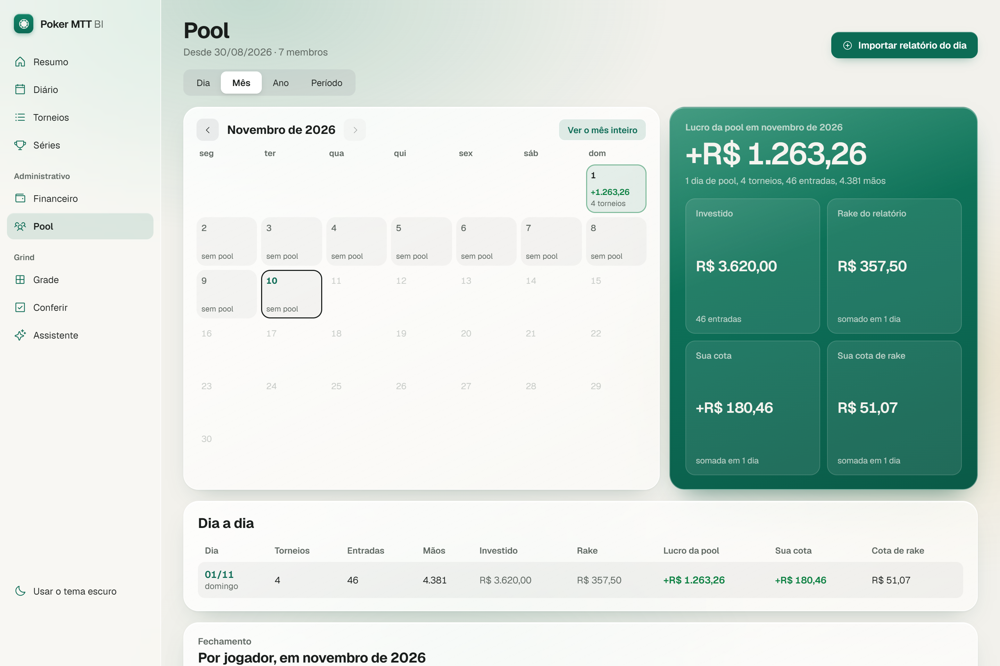
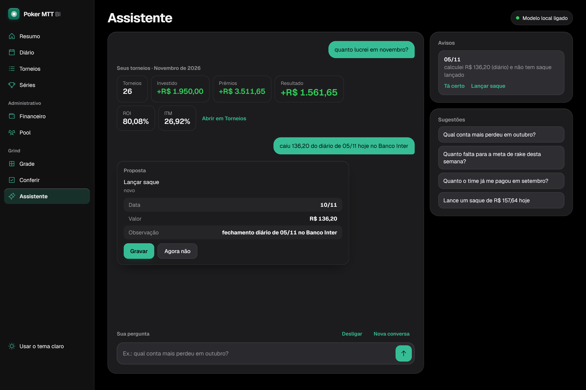
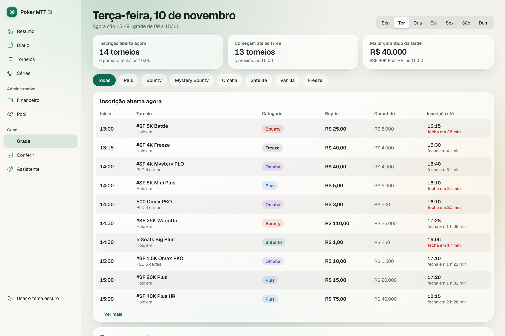

[Português](README.md) · **English** · [Español](README.es.md)

# Poker MTT BI

**The app where I track my poker tournaments: dashboards, the team's finances and a local AI assistant that answers questions and records things for me.**

Closed source · screenshots use fictitious data · the app's interface is in Portuguese

## Why it exists

I play online tournaments (MTTs) every day, on several accounts, as part of a team. The team has its own split rules: makeup, deal, rakeback and a weekly goal. I used to keep it all in a spreadsheet, and checking that every payment matched took hours.

Now I mark the day's records and the app does the rest. It shows how I'm doing, works out what the team owes me and tells me when something doesn't add up.

## Summary

The month at a glance: profit, ROI, the career curve, the best tournament, results by category and by account, and how far I am from this week's rake goal.

## Daily and Tournaments

The calendar shows every day played and its result. Clicking a day shows its highlights. Tournaments holds the full list, with search, filters and spreadsheet export.

## Finances

The app rebuilds the makeup day by day from the very first tournament, using the team's rules for each period. It shows the current week, the closed weeks, the payments received and how much is left to unlock the rakeback.

## Pool

I paste the daily report the team sends. The app checks the totals, splits each player's share and adds up the month.

## Local AI assistant

A chat inside the app, backed by a language model (Qwen, `qwen3.5:4b`) running on my own graphics card. There are no API costs, and no data leaves the computer.

- **I ask instead of digging:** "how much did I make in November?", "which account lost the most in October?", "how much has the team paid me in September?".
- **It records for me:** I type "136.20 from the 11/05 daily settlement landed at the bank" and it prepares the withdrawal entry. Nothing is saved until I click **Gravar** (Save).
- **It warns me:** a computed payment that never arrived, a pool day without its report, a record that needs checking.

The model only understands the request. The app itself does the math, so the assistant shows the same numbers as every other screen.

## Schedule

The team's weekly tournament schedule, pulled from the team's spreadsheet.

## Built with

C# and .NET 10 on the server, React and TypeScript for the interface, SQLite as the database and Ollama for the local model. It runs entirely on my computer, with light and dark themes.

---

Built by **Yan Camargo** · [LinkedIn](https://www.linkedin.com/in/yan-ca%C3%AA-camargo-38b1002a1/) · © 2026, all rights reserved ([LICENSE](LICENSE))
