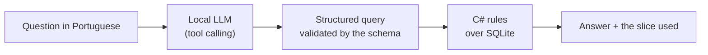
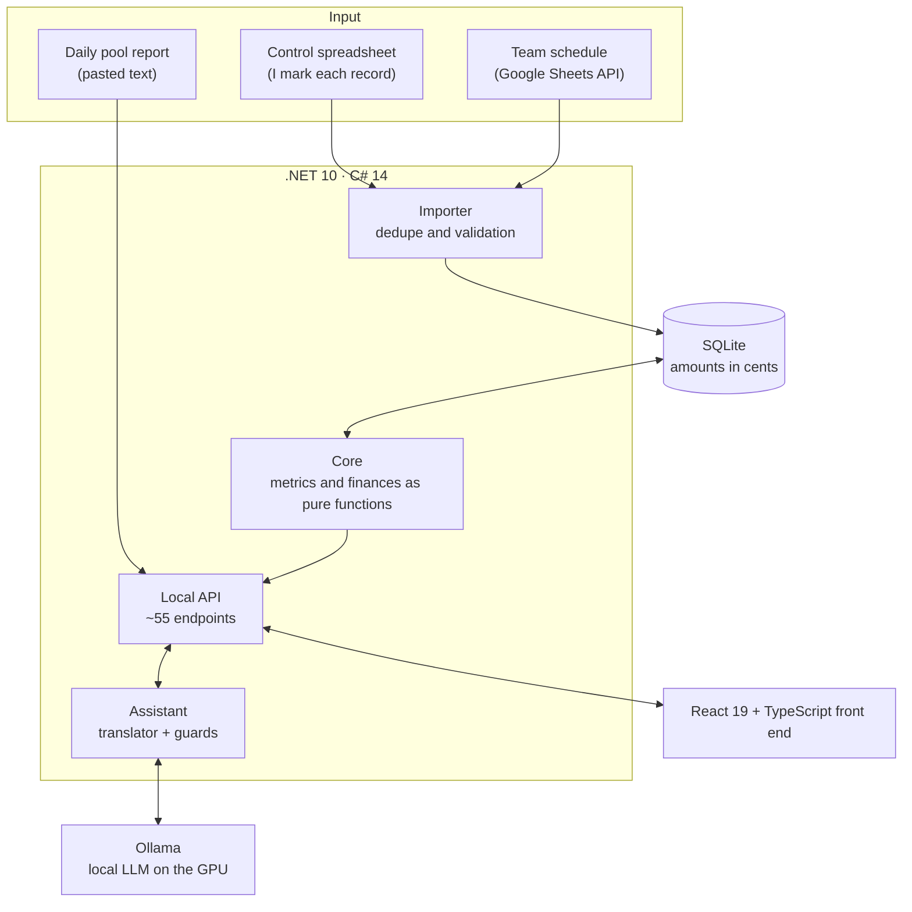

[Português](README.md) · **English** · [Español](README.es.md)

# Poker MTT BI

**A personal BI for online poker tournaments, with the team's finances and an AI assistant that runs 100% locally.**

> [!NOTE]
> **This repository is a showcase.** Poker MTT BI is my own closed-source product. This repo holds only the description, a high-level architecture and the screens. Every image uses **fictitious data**. The app's interface is in Portuguese.

## The problem

I play online poker tournaments (MTTs) at high volume, on 10 accounts, inside a team with its own split rules: deal, rakeback, makeup and a weekly goal. A spreadsheet could not keep up:

- there are thousands of tournaments since July 2025;
- the makeup changes day by day and depends on that week's rule;
- every payment from the team has to match what the system calculates.

So I built the system I wanted to use: one place to see the numbers, audit every record and ask questions in plain language.

## What it does

| Area | What it delivers |
|---|---|
| **Records and audit** | I mark each record in my own control spreadsheet. The system imports, deduplicates, validates and shows what is still unchecked. Every manual correction is logged. |
| **Summary** | Profit, ROI, ITM, average buy-in, a day-by-day career curve, results by category and by account. |
| **Daily and Tournaments** | A monthly calendar, a filterable list and spreadsheet export. |
| **Team finances** | Rebuilds the makeup day by day from the very first tournament. Computes the daily and weekly settlements and the goals, and checks all of it against the payments received. |
| **Pool** | Parses the team's daily report pasted as text and checks it against the report's own totals. A line it cannot parse blocks the save, on purpose. |
| **Assistant** | A chat that answers questions about the numbers and records entries, powered by a language model running on my own GPU. |

## Applied AI: the Assistant

It answers questions like *"which account lost the most in October?"* and records entries like *"I got 157.64 from today's settlement"*. It runs on a **local LLM** (Ollama, `qwen3.5:4b`, 6 GB GPU): zero cost, and no data leaves the machine.

### 1. The model translates, the code answers

The LLM never does math. It only turns the question into a **structured query** (tool calling with a JSON schema), and C# code computes the result from the database. On reads, no number goes through the model, so there are no hallucinated values.

### 2. Model chosen by measurement, not opinion

I measured 7 models from 5 vendors on a corpus of real cases. The criteria were written down **before** looking at any result.

| Model | Correct | Noise¹ | Unwanted writes | Avg. time |
|---|---|---|---|---|
| **qwen3.5:4b** | **19/22** | **0** | **0** | 5.4 s |
| qwen3:8b | 19/22 | 12 | 1 | 50.1 s |
| llama3.1:8b | 14/22 | 24 | 2 | 4.5 s |
| llama3.2:3b | 10/22 | 56 | 0 | 4.3 s |
| granite4:3b | 9/22 | 5 | 0 | 6.8 s |
| nemotron-mini:4b | 3/22 | 0 | 2 | 1.4 s |
| gemma3:4b | no tool calling support | | | |

¹ *Noise is a filter the model adds that the question never asked for. It is the most dangerous error, because it returns a plausible number and nobody notices.*

The bigger model was worse on both axes: it thought longer and invented more filters.

### 3. Schema design beats prompt tweaking

- **Labels instead of dates:** the model got the arithmetic of "last week" wrong. Replacing `startDate`/`endDate` with labels (`last_week`, `last_month`) that the code turns into dates raised accuracy from 13 to 18 and cut latency from 9.3 s to 5.6 s. *If the system can compute it, the model doesn't.*
- **Enums instead of free text** for series and category.
- **No numbers in prompt examples:** the model copied the example's number into its answer.

### 4. Writing to the database safely

- The chat **proposes**: it shows a *before → after* card. **Only a click saves**; typing "yes" does not.
- **Deterministic guards** check the model's output: the value must appear in the user's sentence, and only the field the user mentioned can change.
- **Deleting is impossible by construction**, not just forbidden in the prompt: there is no delete tool.

### 5. Continuous evaluation

Every change to a prompt or a schema runs a regression corpus. Every real mistake I find becomes a new case.

| | First version | Today |
|---|---|---|
| Questions (read) | 41/60 | **68/72** |
| Entries (write) | 28/57 | **54/57, with 0 wrong writes** |

## Architecture

**Principles behind the project:**

- **Runs 100% locally** (Windows + a local server). Nothing goes to the cloud.
- **Money is an integer in cents** (`long`). No `double` ever touches an amount.
- **Hand-written SQL, no ORM.** Additive migrations only, with a backup first.
- **Finances store only the inputs.** Withdrawals, rule periods and pool periods are stored; makeup and settlements are recomputed by pure functions from day one. That is what lets the calculation be checked against every payment received.
- **What was received is the truth.** When the computed value differs from the received one, the formula is wrong.

## Engineering and quality

| | |
|---|---|
| **Backend** | C# 14 / .NET 10, ASP.NET Core, SQLite (`Microsoft.Data.Sqlite`), Google Sheets API |
| **Front end** | React 19, TypeScript, Vite, Tailwind CSS v4, two themes (light and dark) |
| **AI** | Ollama, tool calling with a JSON schema, a custom evaluation corpus |
| **Tests** | **1,800+ automated tests** (xUnit on the backend, Vitest on the front end) |
| **Size** | ~27k lines of C# (code and tests) + ~21k lines of TypeScript, 680+ commits since August 2026 |

### Built with AI coding agents

I direct and review; coding agents (Claude Code and Gemini) do the implementation. The process:

1. **spec → plan → tasks**, with the acceptance proof written before any code;
2. each agent works in an **isolated git worktree**;
3. **"whoever built it doesn't approve it"**: before every merge, a clean-context review runs the build and the tests and reads the diff;
4. **proof by log**: a task only closes with terminal output and exit code 0, never on the agent's word.

## Screens

<table>
<tr>
<td width="50%"> <b>Summary</b>: profit, career curve, rake goal, results by account</td>
<td width="50%"> <b>Tournaments</b>: auditable list, check status, export</td>
</tr>
<tr>
<td> <b>Daily</b>: monthly calendar with each day's result</td>
<td> <b>Pool</b>: team report checked, share per player</td>
</tr>
<tr>
<td> <b>Finances</b>: makeup, closed weeks, payments and team rules</td>
<td> <b>Schedule</b>: the team's weekly tournament schedule   <b>Assistant</b>: chat with the local LLM</td>
</tr>
</table>

## About

Built by **Yan Camargo** (Computer Science · Uninter). I use it every day, and it is the base of a product I plan to offer to other players and teams.

The code is not open. If you want to see it running or talk about it, reach me through [my profile](https://github.com/yancamargo988-afk).

© 2026 Yan Camargo. All rights reserved. See [LICENSE](LICENSE).
