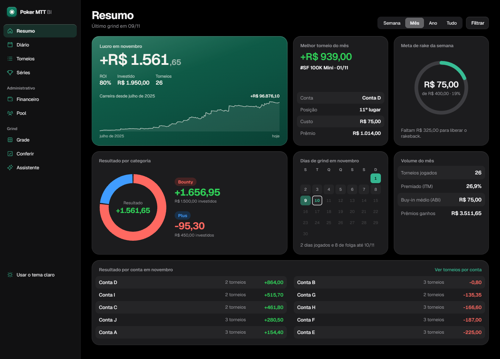
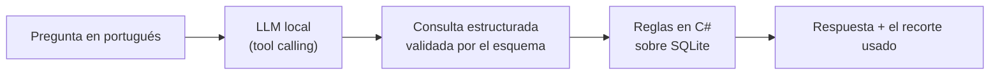
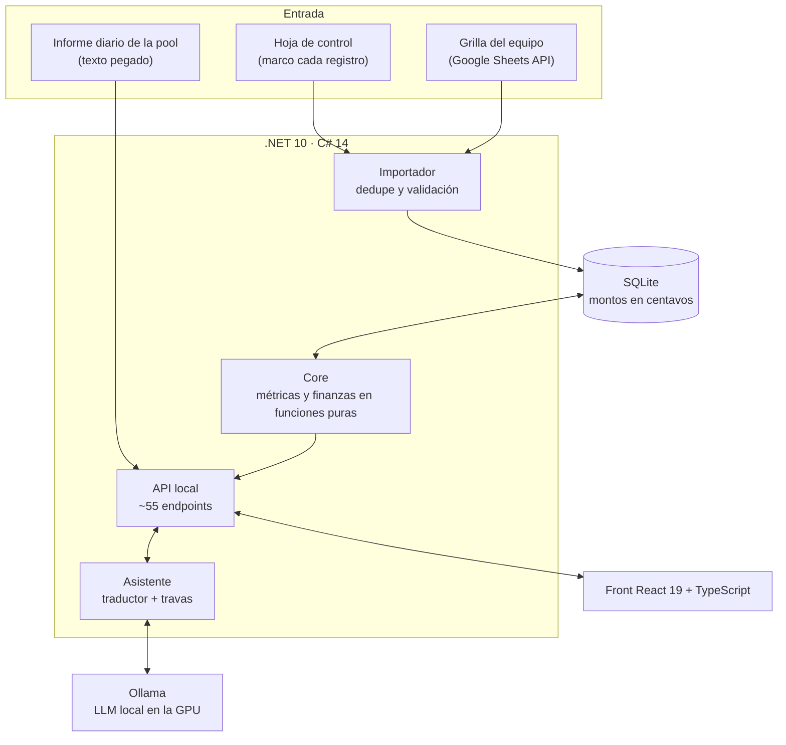
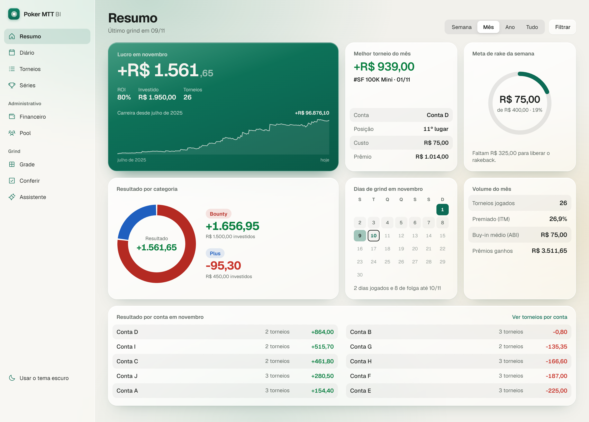
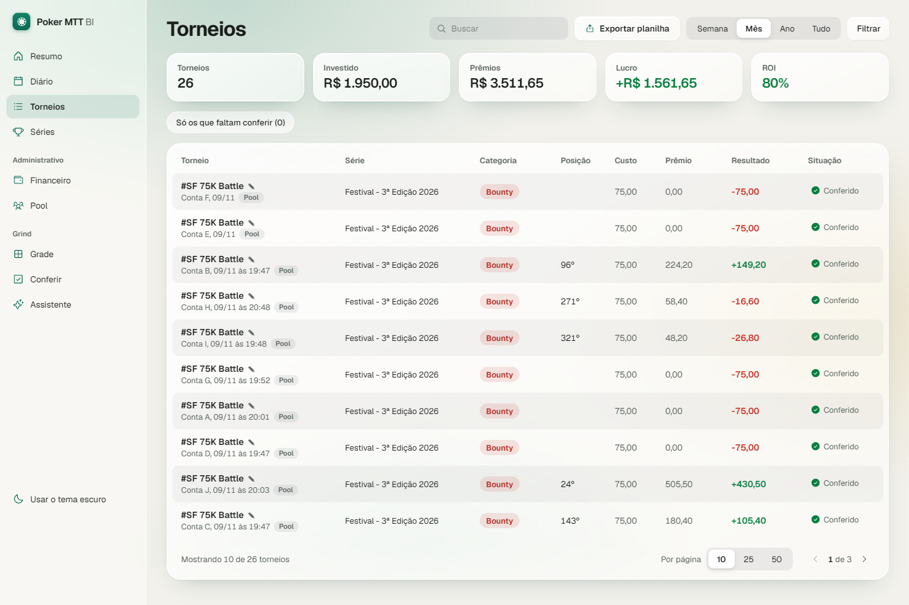
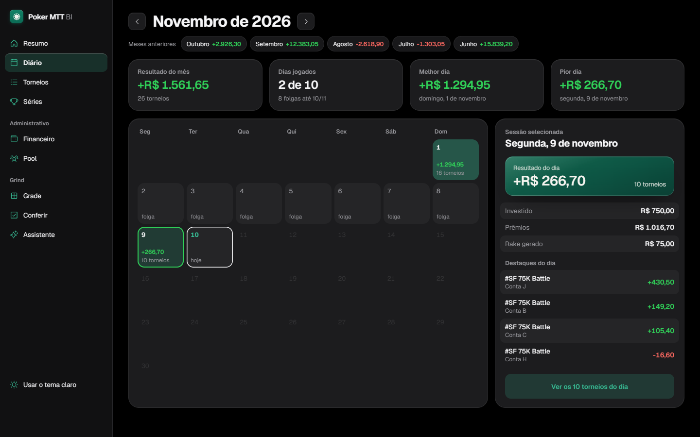
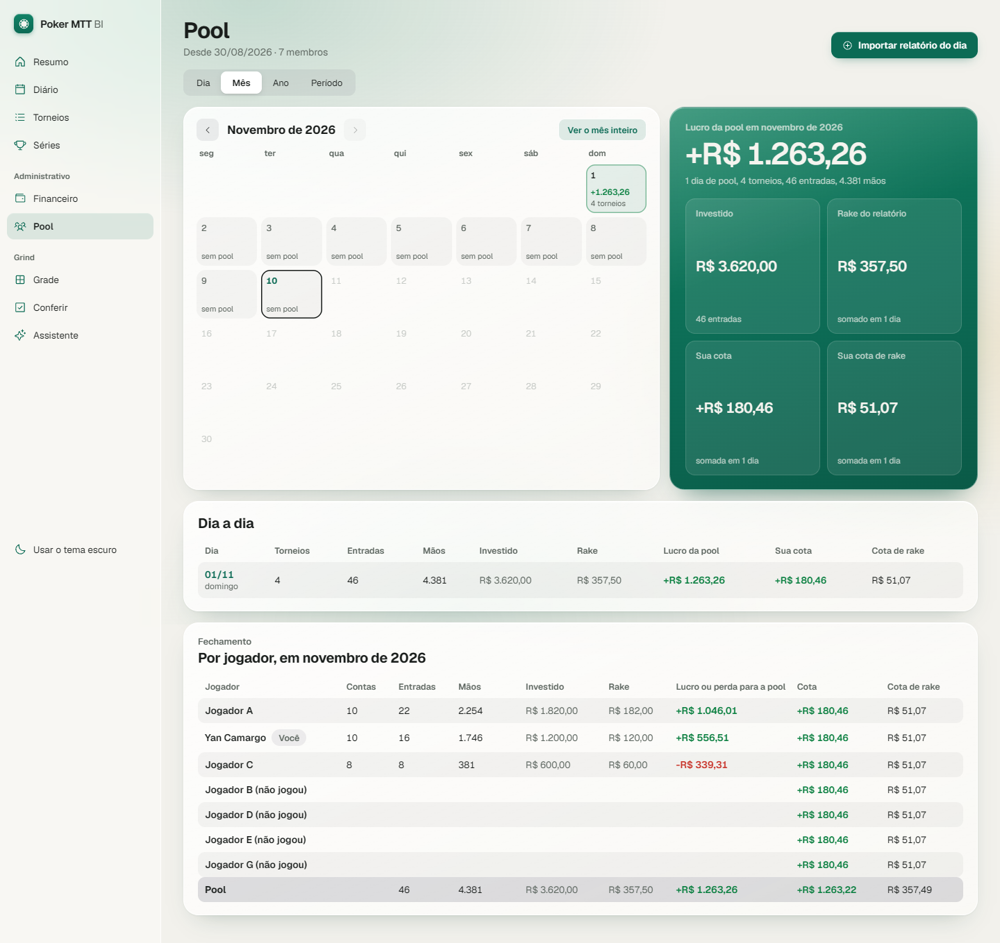
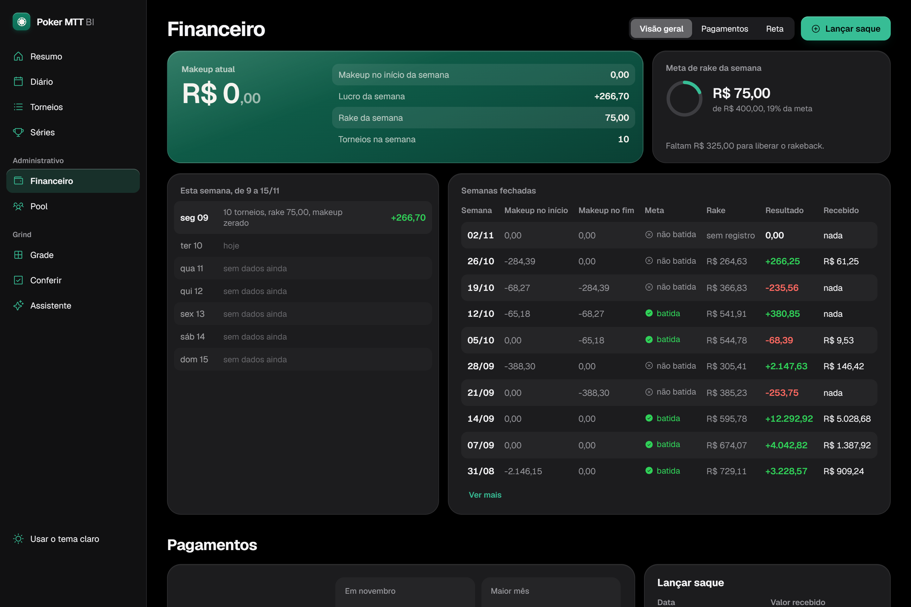
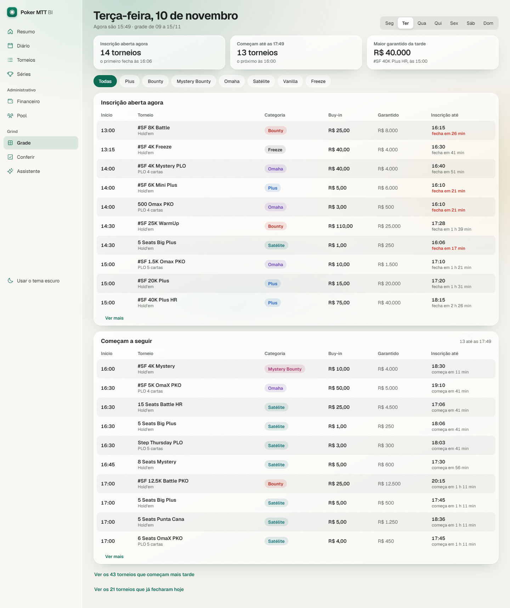
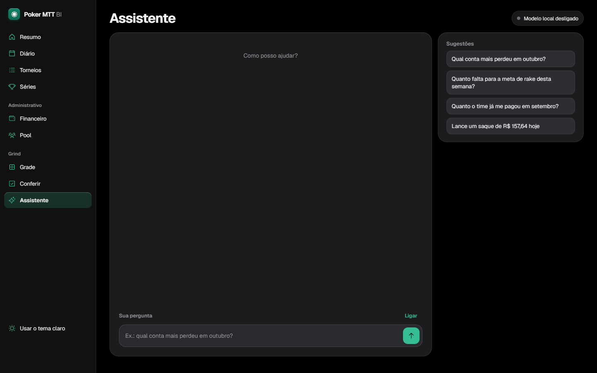

[Português](README.md) · [English](README.en.md) · **Español**

# Poker MTT BI

**BI personal de torneos de póker online, con las finanzas del equipo y un asistente de IA que corre 100% en local.**

> [!NOTE]
> **Este repositorio es una vitrina.** Poker MTT BI es un producto propio, de código cerrado. Aquí están solo la descripción, la arquitectura a alto nivel y las pantallas. Todas las imágenes usan **datos ficticios**. La interfaz de la aplicación está en portugués.

## El problema

Juego torneos de póker online (MTT) en alto volumen, en 10 cuentas, dentro de un equipo con reglas propias de reparto: deal, rakeback, makeup y meta semanal. Una hoja de cálculo no daba abasto:

- son miles de torneos desde julio de 2025;
- el makeup cambia día a día y depende de la regla de esa semana;
- cada pago del equipo tiene que coincidir con lo que calcula el sistema.

Construí el sistema que yo quería usar: un solo lugar para ver los números, auditar cada registro y preguntar en lenguaje natural.

## Qué hace

| Área | Qué entrega |
|---|---|
| **Registro y auditoría** | Marco cada registro en mi hoja de control. El sistema importa, elimina duplicados, valida y muestra lo que falta revisar. Toda corrección manual queda registrada. |
| **Resumen** | Ganancia, ROI, ITM, buy-in medio, curva de carrera día a día, resultado por categoría y por cuenta. |
| **Diario y Torneos** | Calendario del mes, lista filtrable y exportación a hoja de cálculo. |
| **Finanzas del equipo** | Reconstruye el makeup día a día desde el primer torneo. Calcula los cierres diario y semanal y las metas, y lo contrasta todo con los pagos recibidos. |
| **Pool** | Lee el informe diario del equipo pegado como texto y lo contrasta con los totales del propio informe. Una línea que no entiende bloquea el guardado, a propósito. |
| **Asistente** | Chat que responde sobre los números y registra movimientos, con un modelo de lenguaje que corre en mi propia GPU. |

## IA aplicada: el Asistente

Responde preguntas como *"¿qué cuenta perdió más en octubre?"* y registra cosas como *"recibí 157,64 del cierre de hoy"*. Corre en un **LLM local** (Ollama, `qwen3.5:4b`, GPU de 6 GB): costo cero, y ningún dato sale de la máquina.

### 1. El modelo traduce, el código responde

El LLM nunca hace cuentas. Solo convierte la pregunta en una **consulta estructurada** (tool calling con esquema JSON), y el código C# calcula el resultado sobre la base de datos. En la lectura ningún número pasa por el modelo, así que no hay valores alucinados.

### 2. Modelo elegido por medición, no por opinión

Medí 7 modelos de 5 fabricantes con un corpus de casos reales. El criterio se escribió **antes** de ver cualquier resultado.

| Modelo | Aciertos | Ruido¹ | Escrituras indebidas | Tiempo medio |
|---|---|---|---|---|
| **qwen3.5:4b** | **19/22** | **0** | **0** | 5,4 s |
| qwen3:8b | 19/22 | 12 | 1 | 50,1 s |
| llama3.1:8b | 14/22 | 24 | 2 | 4,5 s |
| llama3.2:3b | 10/22 | 56 | 0 | 4,3 s |
| granite4:3b | 9/22 | 5 | 0 | 6,8 s |
| nemotron-mini:4b | 3/22 | 0 | 2 | 1,4 s |
| gemma3:4b | no soporta tool calling | | | |

¹ *Ruido es un filtro que el modelo agrega sin que la pregunta lo pida. Es el error más peligroso, porque devuelve un número plausible y nadie lo nota.*

El modelo más grande fue peor en los dos ejes: pensó más e inventó más filtros.

### 3. El diseño del esquema rinde más que el prompt

- **Etiquetas en lugar de fechas:** el modelo fallaba la aritmética de "la semana pasada". Cambiar `fechaInicio`/`fechaFin` por etiquetas (`semana_pasada`, `mes_pasado`), que el código convierte en fechas, subió los aciertos de 13 a 18 y bajó el tiempo de 9,3 s a 5,6 s. *Si el sistema puede calcularlo, el modelo no lo calcula.*
- **Enum en lugar de texto libre** para serie y categoría.
- **Ejemplos sin números en el prompt:** el modelo copiaba el número del ejemplo en su respuesta.

### 4. Escribir en la base de datos con seguridad

- El chat **propone**: muestra una tarjeta *antes → después*. **Solo el clic guarda**; escribir "sí" no guarda.
- **Travas deterministas** revisan la salida del modelo: el valor tiene que estar escrito en la frase del usuario, y solo cambia el campo mencionado.
- **Borrar es imposible por construcción**, no solo prohibido en el prompt: la herramienta de borrar no existe.

### 5. Evaluación continua

Cada cambio de prompt o de esquema ejecuta un corpus de regresión. Cada error real que encuentro se vuelve un caso nuevo.

| | Primera versión | Hoy |
|---|---|---|
| Preguntas (lectura) | 41/60 | **68/72** |
| Registros (escritura) | 28/57 | **54/57, con 0 escrituras erróneas** |

## Arquitectura

**Principios del proyecto:**

- **Corre 100% en local** (Windows + servidor local). Nada va a la nube.
- **El dinero es un entero en centavos** (`long`). Ningún `double` toca un monto.
- **SQL escrito a mano, sin ORM.** Solo migraciones aditivas, con respaldo antes.
- **Las finanzas guardan solo las entradas.** Retiros, reglas y períodos de pool quedan en la base; el makeup y los cierres se recalculan con funciones puras desde el primer día. Por eso el cálculo se puede contrastar con cada pago recibido.
- **Lo recibido es la verdad.** Cuando el valor calculado difiere del recibido, la que está mal es la fórmula.

## Ingeniería y calidad

| | |
|---|---|
| **Backend** | C# 14 / .NET 10, ASP.NET Core, SQLite (`Microsoft.Data.Sqlite`), Google Sheets API |
| **Frontend** | React 19, TypeScript, Vite, Tailwind CSS v4, dos temas (claro y oscuro) |
| **IA** | Ollama, tool calling con esquema JSON, corpus de evaluación propio |
| **Pruebas** | **+1.800 pruebas automatizadas** (xUnit en el backend, Vitest en el front) |
| **Tamaño** | ~27 mil líneas de C# (código y pruebas) + ~21 mil de TypeScript, 680+ commits desde agosto de 2026 |

### Desarrollo con agentes de IA

Yo dirijo y reviso; agentes de código (Claude Code y Gemini) implementan. El proceso:

1. **spec → plan → tareas**, con la prueba de aceptación escrita antes del código;
2. cada agente trabaja en un **git worktree aislado**;
3. **"quien lo hizo no lo aprueba"**: antes de cada merge, una revisión en contexto limpio ejecuta el build y las pruebas y lee el diff;
4. **prueba por registro**: una tarea solo se cierra con salida de terminal y código 0, nunca por lo que dice el agente.

## Pantallas

<table>
<tr>
<td width="50%"> <b>Resumen</b>: ganancia, curva de carrera, meta de rake y resultado por cuenta</td>
<td width="50%"> <b>Torneos</b>: lista auditable, estado de revisión, exportación</td>
</tr>
<tr>
<td> <b>Diario</b>: calendario del mes con el resultado de cada día</td>
<td> <b>Pool</b>: informe del equipo revisado, cuota por jugador</td>
</tr>
<tr>
<td> <b>Finanzas</b>: makeup, semanas cerradas, pagos y reglas del equipo</td>
<td> <b>Grilla</b>: la grilla semanal de torneos del equipo   <b>Asistente</b>: chat con el LLM local</td>
</tr>
</table>

## Sobre mí

Hecho por **Yan Camargo** (Ciencias de la Computación · Uninter). Lo uso todos los días, y es la base de un producto que pienso ofrecer a otros jugadores y equipos.

El código no es abierto. Si quieres verlo funcionando o conversar sobre él, contáctame por [mi perfil](https://github.com/yancamargo988-afk).

© 2026 Yan Camargo. Todos los derechos reservados. Ver [LICENSE](LICENSE).
