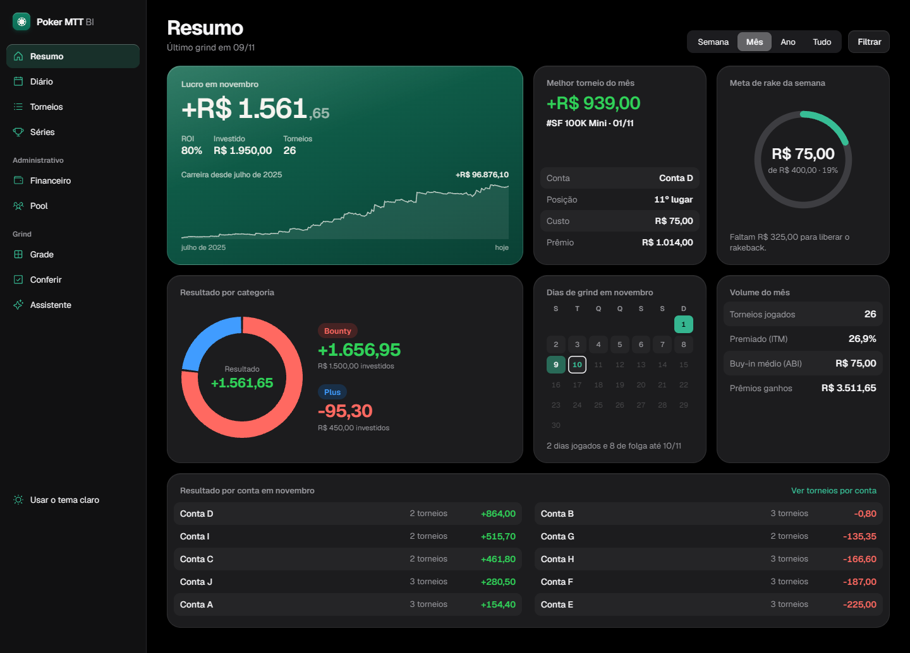
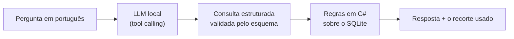
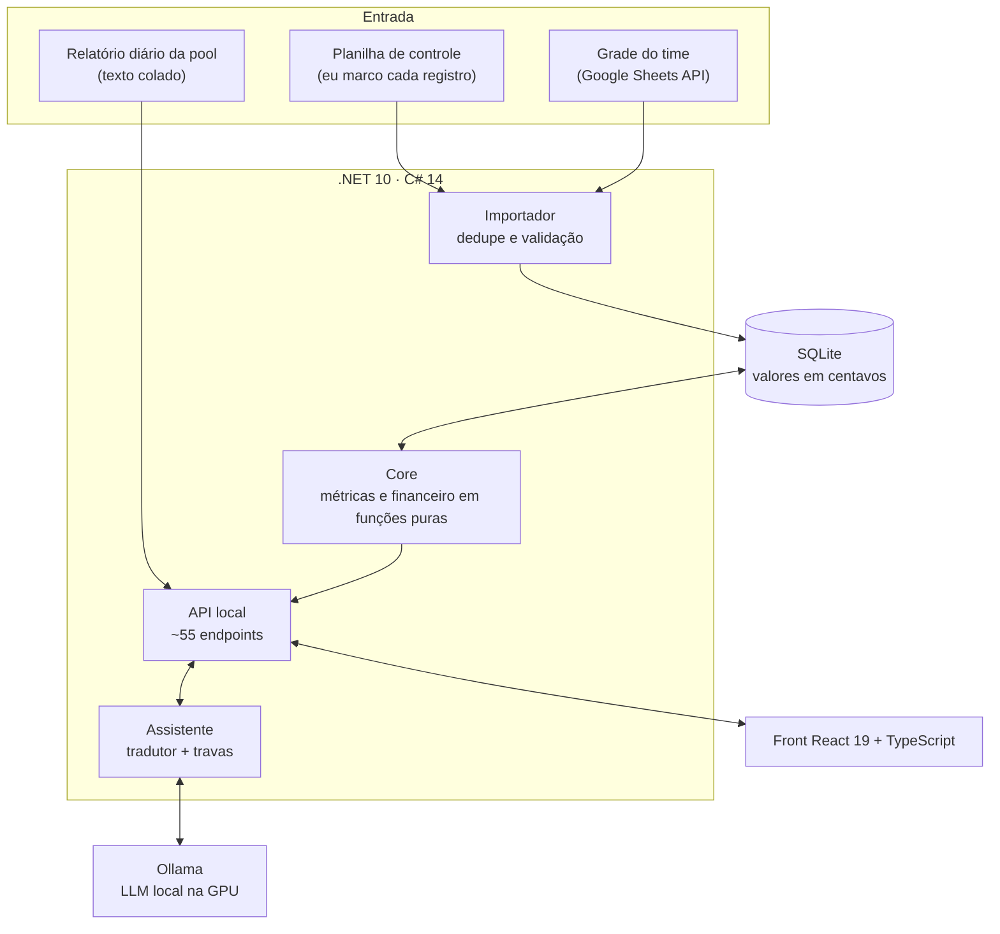
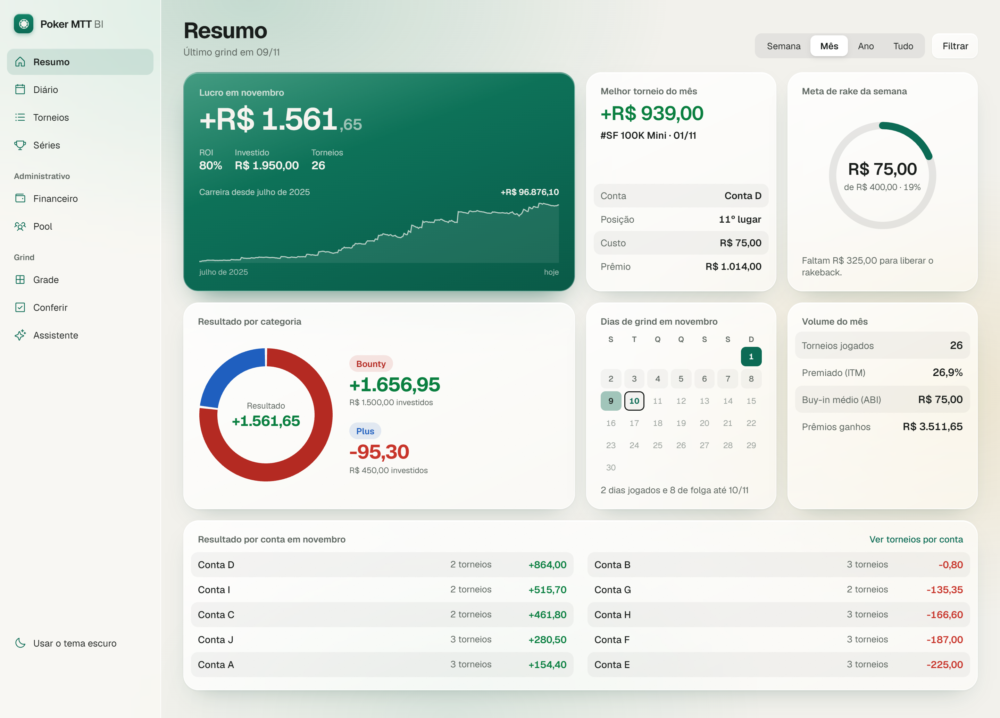
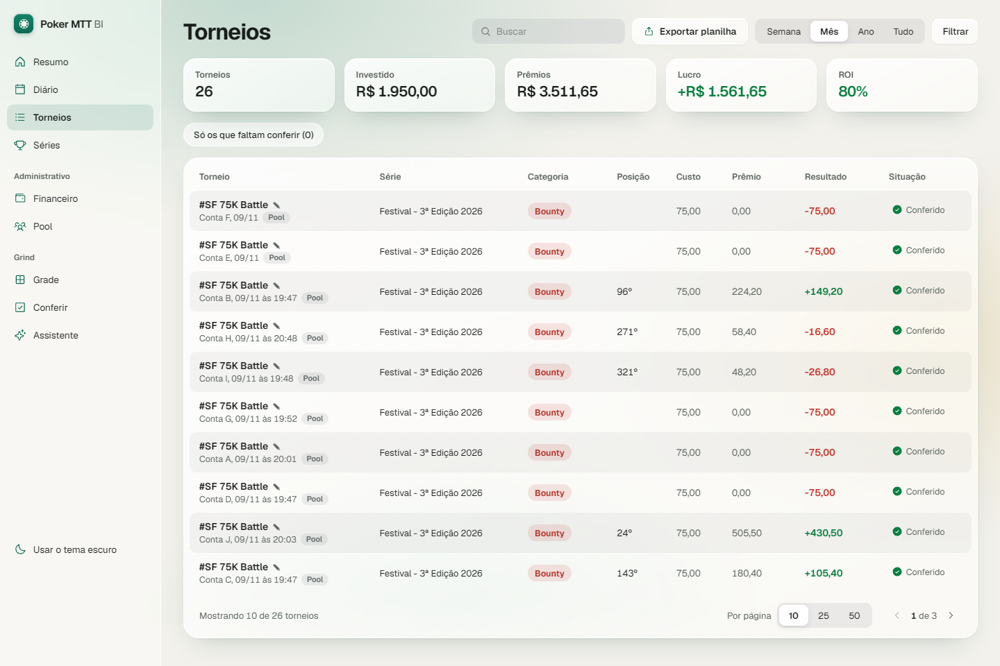
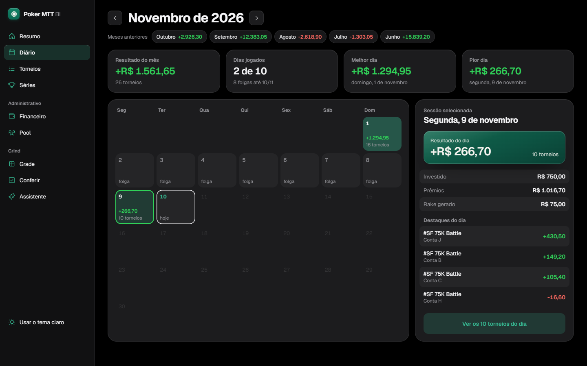
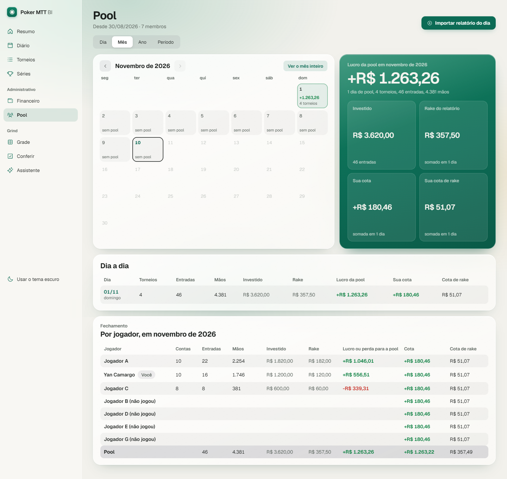
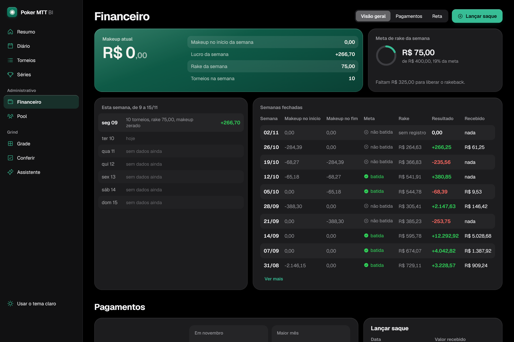
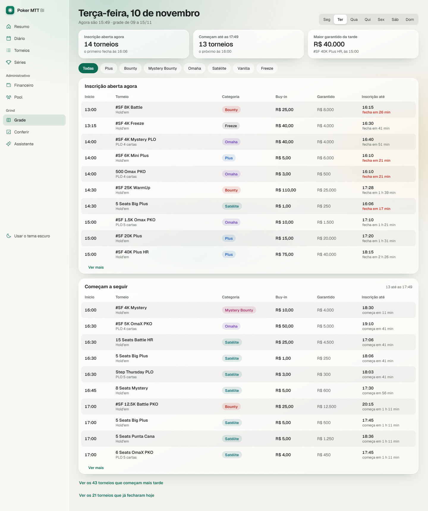
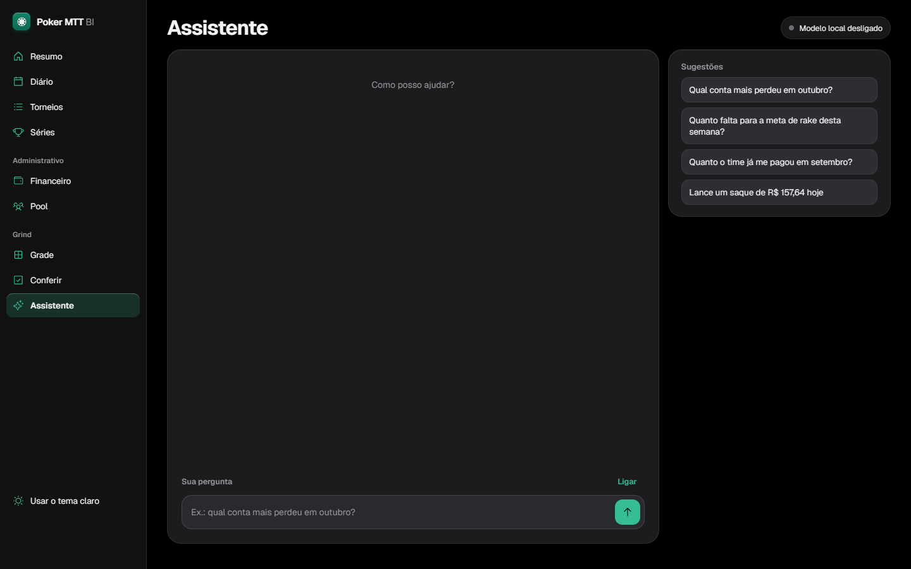

**Português** · [English](README.en.md) · [Español](README.es.md)

# Poker MTT BI

**BI pessoal de torneios de poker online, com financeiro do time e um assistente de IA que roda 100% local.**

> [!NOTE]
> **Este repositório é uma vitrine.** O Poker MTT BI é um produto meu, de código fechado. Aqui ficam só a descrição, a arquitetura em alto nível e as telas. Todas as imagens usam **dados fictícios**.

## O problema

Jogo torneios de poker online (MTT) em volume alto, em 10 contas, dentro de um time com regras próprias de divisão: deal, rakeback, makeup e meta semanal. Uma planilha não dava conta disso:

- são milhares de torneios desde julho de 2025;
- o makeup muda dia a dia e depende da regra da semana;
- cada pagamento do time precisa bater com o que o sistema calcula.

Construí o sistema que eu queria usar: uma tela para ver os números, conferir cada registro e perguntar em português.

## O que ele faz

| Área | O que entrega |
|---|---|
| **Registro e auditoria** | Eu marco cada registro na minha planilha de controle. O sistema importa, tira duplicados, valida e mostra o que ainda falta conferir. Toda correção manual fica registrada. |
| **Resumo** | Lucro, ROI, ITM, buy-in médio, carreira dia a dia, resultado por categoria e por conta. |
| **Diário e Torneios** | Calendário do mês, lista filtrável e exportação para planilha. |
| **Financeiro do time** | Reconstrói o makeup dia a dia desde o primeiro torneio. Calcula os fechamentos diário e semanal e as metas, e confere tudo contra os pagamentos recebidos. |
| **Pool** | Lê o relatório diário do time colado como texto e confere com os totais do próprio relatório. Linha que ele não entende bloqueia a gravação, de propósito. |
| **Assistente** | Chat em português que responde sobre os números e faz lançamentos. Tudo com um modelo de linguagem rodando na minha GPU. |

## IA aplicada: o Assistente

Ele responde perguntas como *"qual conta mais perdeu em outubro?"* e lança coisas como *"recebi 157,64 do fechamento de hoje"*. Roda em um **LLM local** (Ollama, `qwen3.5:4b`, GPU de 6 GB): custo zero, e nenhum dado sai da máquina.

### 1. O modelo traduz, o código responde

O LLM não faz conta. Ele só transforma a pergunta numa **consulta estruturada** (tool calling com esquema JSON). Quem calcula é o C#, sobre o banco. Na leitura, nenhum número passa pelo modelo, então não existe valor alucinado.

### 2. Modelo escolhido por medição, não por opinião

Medi 7 modelos de 5 fabricantes num corpus de casos reais. O critério foi escrito **antes** de ver qualquer resultado.

| Modelo | Acertos | Ruído¹ | Gravações indevidas | Tempo médio |
|---|---|---|---|---|
| **qwen3.5:4b** | **19/22** | **0** | **0** | 5,4 s |
| qwen3:8b | 19/22 | 12 | 1 | 50,1 s |
| llama3.1:8b | 14/22 | 24 | 2 | 4,5 s |
| llama3.2:3b | 10/22 | 56 | 0 | 4,3 s |
| granite4:3b | 9/22 | 5 | 0 | 6,8 s |
| nemotron-mini:4b | 3/22 | 0 | 2 | 1,4 s |
| gemma3:4b | não suporta tool calling | | | |

¹ *Ruído é o filtro que o modelo inventa sem a pergunta pedir. É o erro mais perigoso: devolve um número plausível e ninguém percebe.*

O modelo maior foi pior nos dois eixos: pensou mais e inventou mais filtros.

### 3. Desenho do esquema rende mais que prompt

- **Rótulo em vez de data:** o modelo errava a aritmética de "semana passada". Trocar `dataInicio`/`dataFim` por rótulos (`semana_passada`, `mes_passado`), que o código converte em datas, levou de 13 para 18 acertos e baixou o tempo de 9,3 s para 5,6 s. *Se o sistema consegue calcular, o modelo não calcula.*
- **Enum no lugar de texto livre** para série e categoria.
- **Exemplos sem números no prompt:** o modelo copiava o número do exemplo para a resposta.

### 4. Escrever no banco com segurança

- O chat **propõe**: mostra um cartão *antes → depois*. **Só o clique grava**. Digitar "sim" não grava.
- **Travas determinísticas** conferem a saída do modelo: o valor tem de estar escrito na frase do usuário, e só muda o campo que foi citado.
- **Apagar é impossível por construção**, não só proibido no prompt: a ferramenta de apagar não existe.

### 5. Avaliação contínua

Cada mudança de prompt ou de esquema roda um corpus de regressão. Todo erro real que encontro vira um caso novo.

| | Primeira versão | Hoje |
|---|---|---|
| Perguntas (leitura) | 41/60 | **68/72** |
| Lançamentos (escrita) | 28/57 | **54/57, com 0 gravação errada** |

## Arquitetura

**Decisões que guiam o projeto:**

- **Roda 100% local** (Windows + servidor local). Nada vai para a nuvem.
- **Dinheiro é inteiro em centavos** (`long`). Nenhum `double` encosta em valor.
- **SQL escrito à mão, sem ORM.** Migrações só aditivas, com backup antes.
- **O financeiro guarda só as entradas.** Saques, retas e períodos ficam no banco; makeup e fechamentos são recalculados por função pura desde o primeiro dia. Por isso o cálculo pode ser conferido contra cada pagamento recebido.
- **O que entrou é a verdade.** Quando o calculado diverge do recebido, quem está errada é a fórmula.

## Engenharia e qualidade

| | |
|---|---|
| **Backend** | C# 14 / .NET 10, ASP.NET Core, SQLite (`Microsoft.Data.Sqlite`), Google Sheets API |
| **Frontend** | React 19, TypeScript, Vite, Tailwind CSS v4, dois temas (claro e escuro) |
| **IA** | Ollama, tool calling com esquema JSON, corpus de avaliação próprio |
| **Testes** | **+1.800 testes automatizados** (xUnit no backend, Vitest no front) |
| **Tamanho** | ~27 mil linhas de C# (código e testes) + ~21 mil de TypeScript, 680+ commits desde agosto de 2026 |

### Desenvolvimento com agentes de IA

Eu oriento e reviso; agentes de código (Claude Code e Gemini) executam. O processo:

1. **spec → plano → tarefas**, com o critério de prova escrito antes do código;
2. cada agente trabalha numa **worktree isolada**;
3. **"quem fez não aprova o que fez"**: antes de cada merge, uma revisão em contexto limpo roda build, testes e lê o diff;
4. **prova por registro**: uma tarefa só fecha com saída de terminal e código 0, nunca pelo relato do agente.

## Telas

<table>
<tr>
<td width="50%"> <b>Resumo</b>: lucro, carreira, meta de rake e resultado por conta</td>
<td width="50%"> <b>Torneios</b>: lista auditável, situação de conferência, exportação</td>
</tr>
<tr>
<td> <b>Diário</b>: calendário do mês com o resultado de cada dia</td>
<td> <b>Pool</b>: relatório do time conferido, cota por jogador</td>
</tr>
<tr>
<td> <b>Financeiro</b>: makeup, semanas fechadas, pagamentos e regras do time</td>
<td> <b>Grade</b>: a grade semanal de torneios do time   <b>Assistente</b>: chat com o LLM local</td>
</tr>
</table>

## Sobre

Feito por **Yan Camargo** (Ciência da Computação · Uninter). Uso o sistema todos os dias, e ele é a base de um produto que pretendo oferecer a outros jogadores e times.

O código não é aberto. Se quiser ver o projeto rodando ou conversar sobre ele, fale comigo pelo [meu perfil](https://github.com/yancamargo988-afk).

© 2026 Yan Camargo. Todos os direitos reservados. Veja [LICENSE](LICENSE).
